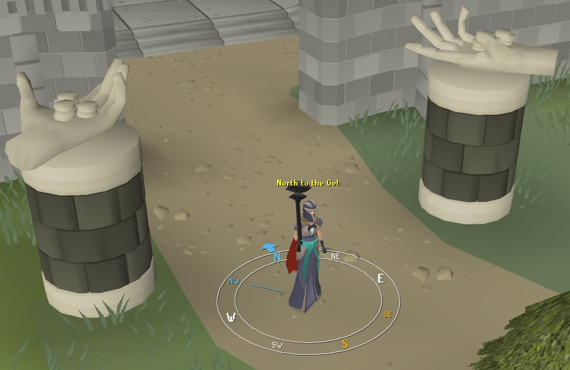
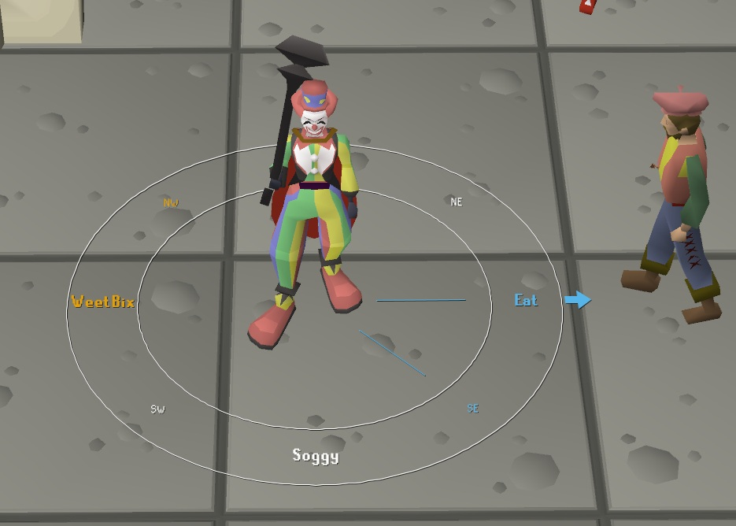

# World compass


## Which way is north again lol?

Tired of saying dumb shit like "Never Eat Soggy Weet-Bix" to calculate which direction you are calling? Well, with this, maybe



Or do what you want with it lol



^ What it looks like. Screenshots from OldSchool RuneScape, owned by Jagex.

## Standout Config Options

- **Show/hide hotkey and mode**, Hide the compass and have it visible only when holding a key if you want.
- **Anchor**, places to render the compass, like, the players feet, the players current tile, the mouse position, the mouse true tile.
- **Direction**, choose which way the compass highlights, your players direction, the direction from the player to the mouse, the destination tile, etc
- **Direction labels**, can be configured in many different ways, like render on the floor, and custom letters/words for the directions
- **Directional indicator**, just like sailing, an arrow pointing in the heading direction
- **Colors, bits and bobs**, almost all the pieces can be enabled/disabled, color changed, font changed, further apart, bigger, smaller, etc.
- **Draw above player/NPCs**, option config to draw the compass behind the player, which can make it harder to see the compass, but looks better imo

## Requirements

- Java 11
- A RuneLite development client

## Running Locally

From the plugin root, start the development client with:

```powershell
.\gradlew.bat run
```

On Windows, the helper script builds the plugin, runs the tests, and then starts the development client:

```powershell
.\run.bat
```

If you use a Jagex Account, follow RuneLite's [Using Jagex Accounts](https://github.com/runelite/runelite/wiki/Using-Jagex-Accounts) guide to log in to the development client.

## Building

```powershell
.\gradlew.bat build
```

## Notes

- Feel free to fork it and make changes. If you do, credit would be appreciated.

## Creator: Kieren Boal

I can't remember the name of directions to save my life, so when I am running any content that requires me to call out a direction (just recently, the newly released Fractured Archives, this has been great for calling out which of the Inert Guardians to run, point and case lol), I always end up needing to say "Never Eat Soggy Weet-Bix", so like if it's "East" I only have to say "Never Eat", but other times I have to say the whole damn thing and my mates give me shit about it so this was the fix lmao 


### Usage of OpenAIs Codex:

- **GPT-6.1 Sol:** Wrote the initial implementation and follow-up code changes
- **GPT-6.0 Luna:** Grunt work, workhorse
